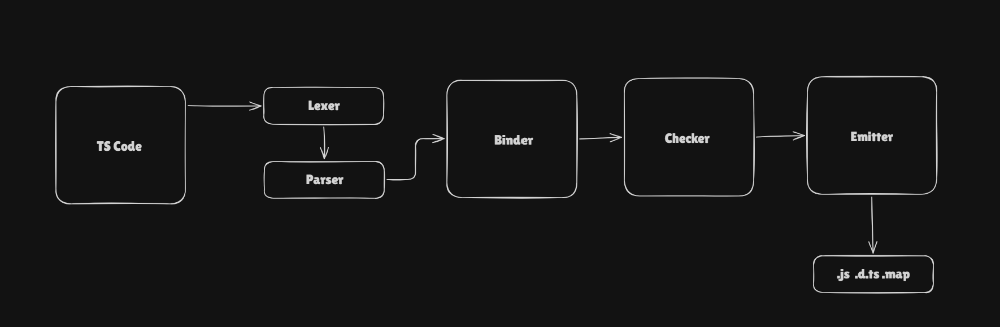

# Typescript

TypeScript adds static type checking to JavaScript, allowing us to catch type-related errors during development rather than relying entirely on JavaScript's runtime behavior.

TypeScript = JavaScript + a compile-time type system + tools for expressing and checking the structure of your program.

## How TS works?


## Type Annotations and Inference
- Annotation: I will explain (Explicitly mentioning what we will use to TS)
- Inference: You understand on your own (TS knows what type is used here based on value)

## Unions and `any`

### Union Types

A **union type** allows a variable to have multiple possible types.

We use the `|` operator to create a union.

```ts
let counting: string | number = "1 million";

counting = 100000;
```

Here, `counting` can contain either a `string` or a `number`.

```ts
counting = "1 million"; // Valid
counting = 100000;     // Valid
counting = true;       // Error
```

`boolean` is not part of the union, so TypeScript gives us an error.

---

### Literal Unions

A union can also specify the **exact values** that are allowed.

```ts
let status: "pending" | "fulfilled" | "rejected" = "pending";
```

Now `status` can only contain one of these three values:

```ts
status = "pending";
status = "fulfilled";
status = "rejected";
```

This is invalid:

```ts
status = "new"; // Error
```

because `"new"` was not included in the union.

This is useful when a variable has a fixed set of possible states.

---

### `any`

`any` is used when we **don't know what type of data we will receive or don't care about the type**.

```ts
let dataIncoming: any;
```

Now the variable can contain different types of data:

```ts
dataIncoming = "hello";
dataIncoming = 100;
dataIncoming = true;
dataIncoming = { name: "Sam" };
```

TypeScript will not complain about these assignments.

We can also access properties or call methods without TypeScript checking whether they actually exist:

```ts
let dataIncoming: any = "hello";

dataIncoming.toUpperCase();
dataIncoming.someFunction();
```

The second operation could fail at runtime, but TypeScript won't give us a type error because we told it that the value is `any`.

#### When can `any` be useful?

For example, when receiving data from an external source where we don't know the structure beforehand:

```ts
let dataIncoming: any;
```

We can then work with whatever data we receive without TypeScript forcing us to define its structure first.

## Type unknown and narrowing

### `unknown`

`unknown` is a safer alternative to any when we don't know the type of a value yet.

The key difference is:

`any` → TypeScript allows us to do almost anything with the value.
`unknown` → TypeScript forces us to determine/narrow the type before using it.
let value: unknown = "Hello";

We cannot directly perform operations on value:

value.toUpperCase(); // ❌ Error

We first need to determine its type:

if (typeof value === "string") {
    value.toUpperCase(); // ✅
}

#### Mental Model
`unknown` = "I don't know the type yet. Prove what it is before using it."

This makes `unknown` particularly useful for external/untrusted data, such as API responses, user input, or parsed JSON.

### Type narrowing
`Type narrowing` means reducing a broad type into a more specific type by checking some condition.

For example:

```ts
function getNum(kind: string | number) {
    if (typeof kind === "string") {
        return "Number can only be read";
    }

    return "Number can be used to perform operations";
}
```

Initially:

```ts
kind: string | number
```

TypeScript doesn't know whether kind is a string or a number.

After:

```ts
typeof kind === "string"
```

TypeScript knows that inside the if block:

```ts
kind: string
```

Therefore, after the if block, TypeScript knows that kind must be:
```ts
kind: number
```
Common narrowing techniques
- typeof

Used mainly for primitive types:
```ts
if (typeof value === "string") {
    // value is string
}

if (typeof value === "number") {
    // value is number
}
```
- Truthiness check
```ts
function getAddress(addr?: string) {
    if (addr) {
        return "Save Address";
    }

    return "No address is saved";
}
```

Here:

```ts
addr?: string
```

means:

```ts
addr: string | undefined
```

The condition:

```ts
if (addr)
```

narrows addr to a usable string inside the block.

#### Mental Model
`Narrowing` = "I have a broad type; this condition gives TypeScript enough information to make it more specific."

## Creating Custom Types

We can create our own types using the type keyword.

```ts
type Food = {
    orderID: string,
    orderName: string,
    quantity: number
}
```

Now Food represents the structure an object must follow.

```ts
const order: Food = {
    orderID: "ORD001",
    orderName: "Pizza",
    quantity: 2
};
```

TypeScript will check that the object contains the expected properties with the correct types.

For example:

```ts
const order: Food = {
    orderID: "ORD001",
    orderName: "Pizza",
    quantity: "2" // ❌ Error
};
```

quantity is expected to be a number, but "2" is a string.

### Why Create Custom Types?

`Custom types` are especially useful when working with structured data, such as API responses.

Suppose an API returns:

```json
{
    "orderID": "ORD001",
    "orderName": "Pizza",
    "quantity": 2
}
```

We can describe the expected structure:

```ts
type Food = {
    orderID: string,
    orderName: string,
    quantity: number
}
```

Then use that type throughout our application:

```ts
function processOrder(order: Food) {
    console.log(order.orderName);
    console.log(order.quantity);
}
```

This gives us:
- Autocomplete
- Compile-time checking
- Clear documentation of the data structure
- Fewer mistakes when accessing properties

### Mental Model

`type` = "Define the shape that a value/object should have."

## Type Assertions

Type assertion is a technique used to tell TypeScript **how we want a value to be treated by the type system**.

It does **not** convert or change the actual value at runtime.

### 1. Forceful Type Assertion

Sometimes TypeScript does not know the type we intend to work with. We can use the `as` keyword to tell TypeScript to treat a value as a specific type.

```ts
let request: any = "42";

// TypeScript cannot provide useful type information
// because request is `any`.
let numeric: number = request.length;

// Tell TypeScript to treat request as a string
numeric = (request as string).length;
```

Here:

```ts
request as string
```

means:

> "TypeScript, treat `request` as a `string` from this point in this expression."

Since strings have a `length` property, TypeScript can provide the appropriate type information.

#### Important

Type assertion does **not** perform runtime validation or conversion.

```ts
const value = 42 as unknown as string;
```

This does not turn the number `42` into a string. The runtime value is still a number.

So type assertion should be used when **we already have sufficient knowledge about the value's type**, but TypeScript cannot infer it correctly.

---

### Type Assertion with API / JSON Data

A common situation is receiving data from an external source.

```ts
type Book = {
    name: string;
};

const bookData = '{"name": "Half Girlfriend"}';

const bookObject = JSON.parse(bookData) as Book;

console.log(bookObject.name);
```

`JSON.parse()` returns `any`, so TypeScript does not know the structure of the parsed object.

By writing:

```ts
JSON.parse(bookData) as Book
```

we tell TypeScript:

> "Treat the parsed value as a `Book`."

Now TypeScript knows that `bookObject` has:

```ts
name: string
```

#### Important

This still does **not validate** that the JSON actually contains a valid `Book`.

For example:

```ts
const bookObject = JSON.parse('{"title": "Half Girlfriend"}') as Book;
```

TypeScript will accept the assertion, even though the runtime object does not contain the required `name` property.

For data coming from untrusted sources such as APIs, validation libraries such as Zod can be used when runtime validation is required.

---

### DOM Type Assertion

TypeScript also provides specific types for DOM elements.

```ts
const inputElement =
    document.getElementById("username") as HTMLInputElement;
```

`getElementById()` returns:

```ts
HTMLElement | null
```

TypeScript does not automatically know that the element with the `"username"` ID is specifically an input element.

We can assert:

```ts
as HTMLInputElement
```

Now TypeScript knows that we intend to use it as an `HTMLInputElement`.

For example:

```ts
inputElement.value;
```

TypeScript can provide the properties and methods available on `HTMLInputElement`.

Again, this does not check the DOM element at runtime. If the element is actually a different type, the assertion does not magically change it.

---

## The `never` Type

`never` represents a situation where **a value can never exist**.

One common use is **exhaustive checking of union types**.

Consider:

```ts
type Role = "admin" | "user";
```

There are currently only two possible values:

```text
"admin"
"user"
```

We can handle both:

```ts
function redirectOnRole(role: Role): void {
    if (role === "admin") {
        console.log("Admin Dashboard");
        return;
    }

    if (role === "user") {
        console.log("User Dashboard");
        return;
    }

    role;
}
```

After the two checks, TypeScript knows that there are no remaining possible values for `role`.

Therefore, in the final section:

```ts
role;
```

the type of `role` is:

```ts
never
```

The important idea is:

```text
Role
 ↓
"admin" | "user"
 ↓
remove "admin"
 ↓
"user"
 ↓
remove "user"
 ↓
never
```

So `never` can help us detect whether we have handled **every possible case**.

---

### Exhaustive Checking with `never`

A common pattern is to create a function that accepts only `never`:

```ts
function assertNever(value: never): void {
    console.log("All roles are checked")
}
```

Then:

```ts
type Role = "admin" | "user";

function redirectOnRole(role: Role): void {
    if (role === "admin") {
        console.log("Admin Dashboard");
        return;
    }

    if (role === "user") {
        console.log("User Dashboard");
        return;
    }

    assertNever(role);
}
```

Because `assertNever()` only accepts `never`, TypeScript verifies that all possible `Role` values have been handled.

This becomes especially useful when the union changes:

```ts
type Role = "admin" | "user" | "moderator";
```

Now `"moderator"` has not been handled.

Therefore, at:

```ts
assertNever(role);
```

TypeScript will produce an error because `role` is still:

```ts
"moderator"
```

rather than:

```ts
never
```

This alerts us that we need to add handling for the new role.

## Interfaces, Intersections, and Property Modifiers

### Interfaces

An `interface` defines a contract that describes the properties and methods an object should have. When a class implements an interface, it must satisfy that contract.

Interfaces are commonly used to define contracts for classes.

```ts
interface OrderStatus {
    status: "received" | "cooking" | "served";
}
```

Here, `OrderStatus` requires an object to have a `status` property whose value must be one of the three specified strings.

#### Using interfaces with classes

```ts
type FoodOrder = {
    id: number;
    item: string;
};

interface OrderStatus {
    status: "received" | "cooking" | "served";
}

class Order implements FoodOrder, OrderStatus {
    id = 12940;
    item = "Chinese";
    status: "received" | "cooking" | "served" = "received";
}
```

* `implements` checks whether the class satisfies the specified type contracts.
* A class can implement multiple interfaces or object-shaped type aliases.
* Using an `interface` for a class contract is a common convention, but it is not mandatory.
* Use the primitive type `number` rather than the wrapper type `Number`.

#### Why can't a class implement a union of object types?

```ts
type Response =
    | { ok: "send" }
    | { ok: "don't send" };
```

This is a union type. It describes two alternative object shapes.

A class cannot directly implement this union:

```ts
// Invalid
class MyResponse implements Response {}
```

Instead, use the union as a type for a value or property, or define an interface if the class needs a contract.

```ts
interface Response {
    ok: "send" | "don't send";
}

class MyResponse implements Response {
    ok: "send" | "don't send" = "send";
}
```

**Remember:** `implements` checks whether a class instance satisfies a type's structure. It does not require that structure to be declared using `interface`, but a union type cannot be implemented directly.

### Defining Object Contracts with Interfaces

An `interface` can describe the properties and methods an object must contain. When an object is assigned to that interface type, TypeScript checks whether it satisfies the contract.

```ts
interface FoodOrder {
    name: string;
    quantity: number;
    serveFood(): void;
}

const newOrder: FoodOrder = {
    name: "Italian",
    quantity: 2,
    serveFood() {
        console.log("Food is served");
    }
};
```

- `name` must be a string.
- `quantity` must be a number.
- `serveFood()` must be a method that returns `void`.

**Remember:** An interface can describe both data properties and method signatures. The object provides the actual method implementation.

### Index Signatures

An index signature allows an object to contain properties with dynamic keys, provided those keys and their values follow specified types.

```ts
interface MenuInfo {
    [name: string]: number;
}

const menu: MenuInfo = {
    chinese: 245789,
    italian: 597893
};

console.log(menu.chinese);
```

- `[name: string]` means property keys must be strings.
- `number` means every property's value must be a number.
- Property names such as `chinese` and `italian` do not need to be declared individually in advance.

An invalid value produces a type error:

```ts
const menu: MenuInfo = {
    chinese: "245789" // Error: string is not assignable to number
};
```

**Important:** JavaScript objects cannot contain duplicate own property names as separate entries. If the same key is written twice in an object literal, JavaScript normally keeps the last value. TypeScript's index signature does not enforce unique keys in that sense.

### Declaration Merging

When multiple interfaces with the same name are declared in the same scope, TypeScript automatically merges their members into a single interface.

```ts
interface User {
    name: string;
}

interface User {
    age: number;
}

const newUser: User = {
    name: "Samuel",
    age: 22
};
```

After declaration merging, `User` requires both `name` and `age`.

This behavior is called **declaration merging**.

- All declarations must use the same interface name and be in a compatible scope.
- Conflicting declarations can produce compilation errors.
- This differs from type aliases, which cannot be redeclared using the same name in the same scope.

Declaration merging is useful when extending existing interfaces, including interfaces exposed by libraries or other parts of an application.

### Extending Interfaces

An interface can extend one or more existing interfaces to inherit their properties and methods.

```ts
interface A {
    a: string;
}

interface B {
    b: string;
}

interface C extends A, B {
    c: string;
}

const newLetter: C = {
    a: "",
    b: "",
    c: ""
};
```

Here, `C` inherits the requirements of both `A` and `B`, then adds its own property, `c`.

Therefore, an object of type `C` must contain all three properties: `a`, `b`, and `c`.

An interface can extend multiple interfaces by separating their names with commas.

**Declaration merging vs. extending**

- **Declaration merging:** Multiple declarations with the same interface name are combined automatically.
- **Extending:** A new interface explicitly inherits from one or more existing interfaces using `extends`.

Both approaches let you build upon existing contracts, but they serve different purposes.

### Intersection Types (`&`)

An intersection combines multiple type requirements. A value must satisfy all the combined types.

```ts
type ResponseBody = {
    body: string;
};

type ResponseStatus = {
    status: "success" | "error";
};

type NewResponse = ResponseBody & ResponseStatus;
```

`NewResponse` requires both the `body` and `status` properties.

```ts
function createResponse(obj: NewResponse) {
    console.log(obj.body);
    console.log(obj.status);
}

createResponse({
    body: "Order created",
    status: "success"
});
```

#### Why use intersections?

Intersections are useful when existing types need to be combined into a new type without repeating their properties.

For example, `ResponseBody` and `ResponseStatus` can be defined independently and then combined into `NewResponse`.

**Remember:**

* `|` means OR: one of the alternatives.
* `&` means AND: all the type requirements must be satisfied.

---

### Property Modifiers: `readonly` and Optional Properties (`?`)

Property modifiers change how a property can be used.

#### The `readonly` modifier

The `readonly` modifier prevents a property from being reassigned after initialization.

```ts
type Config = {
    readonly id: number;
    appName: string;
    version: number;
    description?: string;
};

const newConfig: Config = {
    id: 123455,
    appName: "New App",
    version: 1
};
```

The following assignments are allowed:

```ts
newConfig.appName = "Updated App";
newConfig.version = 2;
```

But this assignment produces a TypeScript error:

```ts
newConfig.id = 999; // Error: id is readonly
```

**Important:** `readonly` prevents reassignment through the TypeScript type system. It does not make an object deeply immutable at runtime.

#### Optional properties (`?`)

The `?` modifier makes a property optional.

```ts
type Config = {
    appName: string;
    description?: string;
};
```

Both objects are valid:

```ts
const config1: Config = {
    appName: "New App"
};

const config2: Config = {
    appName: "New App",
    description: "An application"
};
```

If `description` is provided, it must be a string.

When reading an optional property, its value may be `undefined`:

```ts
console.log(config1.description); // undefined
```

## Objects and Utility Types

### Objects and Type Annotations

When creating objects, we can define the shape of the object using a type annotation. This specifies the properties and the types of values they can contain.

```ts
let food: {
    name: string;
    quantity: number;
};

food = {
    name: "Dosa",
    quantity: 2
};
```

Here, `food` must contain a `name` of type `string` and a `quantity` of type `number`.

Defining the object type separately makes it easier to reuse the same structure.

### Type Aliases

A **type alias** allows us to give a name to a type so that we can reuse it throughout our application.

```ts
type FoodOrder = {
    id: number;
    name: string;
    quantity: number;
};

const newOrder: FoodOrder = {
    id: 1233,
    name: "Chinese",
    quantity: 1
};
```

Instead of repeatedly writing the object's structure, we can use `FoodOrder` wherever that type is needed.

### Nested Objects and Arrays

We can use one type inside another type. This helps us represent more complex data structures.

```ts
type Transaction = {
    id: number;
    date: Date;
};

type Address = {
    floor: number;
    addressLine1: string;
    addressLine2?: string;
};

type Account = {
    username: string;
    transactions: Transaction[];
    address: Address;
};
```

#### Important points

* `Transaction[]` represents an array of transactions.
* `address: Address` means the address property must follow the `Address` structure.
* `addressLine2?: string` makes `addressLine2` optional.
* `date: Date` expects a JavaScript `Date` object, not an arbitrary date string.

The `?` modifier allows a property to be omitted.

### Structural Typing

TypeScript primarily uses **structural typing**. An object can be assigned to a type when it contains the required properties with compatible types, even if it has additional properties.

```ts
type Cup = {
    size: "small" | "medium" | "large";
};

let mediumCup = {
    size: "medium" as const,
    material: "steel",
    price: 500
};

let smallCup: Cup = mediumCup;

console.log(smallCup.size); // "medium"
```

The assignment is valid because `mediumCup.size` has the literal type `"medium"`, which is allowed by `Cup`.

The additional properties, `material` and `price`, do not prevent the assignment.

#### Why use `as const` here?

Without `as const`, TypeScript generally infers the mutable object's `size` property as `string`. That is too broad for `Cup`, which accepts only three specific string literals.

```ts
size: "medium" as const
```

This preserves the literal type `"medium"` for that property.

#### Important distinction

After the assignment:

* Both variables reference the same object.
* The object still contains `size`, `material`, and `price`.
* TypeScript still treats `smallCup` as type `Cup`.
* Accessing `smallCup.material` produces a type error because `material` is not declared in `Cup`.

Structural typing is useful when we only need specific properties from an object that may contain additional data.

However, TypeScript does not validate external data at runtime. Use runtime validation when data comes from an API or another untrusted source.

### `Partial<T>`

`Partial<T>` makes every property in a type optional.

```ts
type PropertyLand = {
    plotNo: number;
    address: string;
};

function updateProperty(updates: Partial<PropertyLand>) {
    console.log("All the updates", updates);
}

updateProperty({ address: "Jadunagar Delhi" });
updateProperty({ plotNo: 5 });
updateProperty({});
```

The resulting type is equivalent to:

```ts
type PropertyUpdate = {
    plotNo?: number;
    address?: string;
};
```

#### Why is this useful?

When updating a record, we might want to change only one property instead of supplying every property.

For example, a user might update only their address without changing their plot number.

#### Important consideration

An empty object `{}` is valid because all properties are optional. However, it might represent an update request that changes nothing.

If at least one update is required, validate that condition at runtime.

```ts
function updateProperty(updates: Partial<PropertyLand>) {
    if (Object.keys(updates).length === 0) {
        throw new Error("At least one update is required");
    }

    console.log("All the updates", updates);
}
```

### `Required<T>`

`Required<T>` makes every property required, even if the original type marked some properties as optional.

```ts
type PropertyDraft = {
    plotNo?: number;
    address?: string;
};

function updateByBuilder(updates: Required<PropertyDraft>) {
    console.log("All new updates:", updates);
}

updateByBuilder({
    plotNo: 5,
    address: "Ultinagar, Chouras Baug"
});
```

The resulting type is equivalent to:

```ts
type CompleteProperty = {
    plotNo: number;
    address: string;
};
```

If either property is missing, TypeScript reports an error.

#### Important distinction

Your original `PropertyLand` type already required both properties. Applying `Required<PropertyLand>` would not change that type.

`Required<T>` is most useful when the original type contains optional properties.

### `Pick<T, K>`

`Pick<T, K>` selects specific properties from an existing type.

```ts
type User = {
    name: string;
    email: string;
    password: string;
};

type UpdateUser = Pick<User, "name" | "email">;

const data: UpdateUser = {
    name: "Hello",
    email: "ace@gmail.com"
};
```

`UpdateUser` contains only `name` and `email`.

Both properties remain required because `Pick` preserves their original optional or required status.

#### Making the selected properties optional

If we want to update either the name, the email, or both, we can combine `Pick` with `Partial`.

```ts
type UpdateUser = Partial<Pick<User, "name" | "email">>;
```

This is equivalent to:

```ts
type UpdateUser = {
    name?: string;
    email?: string;
};
```

The order matters conceptually:

1. `Pick` selects which properties are allowed.
2. `Partial` makes those selected properties optional.

This is useful when creating separate input types for user creation and profile updates.

### `Omit<T, K>`

`Omit<T, K>` creates a type by excluding specified properties from an existing type.

```ts
type GeneralUpdate = Partial<Omit<User, "password">>;
```

First, `Omit<User, "password">` removes the `password` property.

The resulting type is:

```ts
type GeneralUpdate = {
    name: string;
    email: string;
};
```

Then, `Partial` makes both remaining properties optional:

```ts
type GeneralUpdate = {
    name?: string;
    email?: string;
};
```

Now the general update type permits changing the name, the email, or both, without including a password field.

This is useful when designing separate types for different operations.

**Security note:** TypeScript types alone do not prevent a client from sending extra fields at runtime. API handlers must validate incoming data and explicitly control which fields can be changed.

### Quick Reference

| Utility type  | Purpose                       |
| ------------- | ----------------------------- |
| `Partial<T>`  | Makes all properties optional |
| `Required<T>` | Makes all properties required |
| `Pick<T, K>`  | Selects specified properties  |
| `Omit<T, K>`  | Excludes specified properties |

## Functions

### Declaring Types Inline

We can define the types of function parameters directly when declaring the function.

```ts
function createOrder(id: number, name: string, quantity: number) {
    return {
        id,
        name,
        quantity
    };
}
```

- `id: number` means the `id` parameter must be a number.
- `name: string` means the `name` parameter must be a string.
- `quantity: number` means the `quantity` parameter must be a number.

**When to use:** When the types are simple and only need to be declared for that function.

TypeScript can infer the return type from the returned object. In this example, it infers an object containing `id`, `name`, and `quantity` with their respective types.

### Declaring Types Separately and Reusing Them

Instead of declaring an object's structure repeatedly, we can define a reusable type using `type`.

```ts
type FoodOrder = {
    id: number;
    name: string;
    quantity: number;
};

function createNewOrder(order: FoodOrder) {
    return {
        id: order.id,
        name: order.name,
        quantity: order.quantity
    };
}
```

- `FoodOrder` defines the expected structure of an order.
- `order: FoodOrder` requires the argument to satisfy that structure.
- We can reuse `FoodOrder` in multiple functions or variables.

**When to use:** When an object structure is shared across different parts of the application, such as controllers, services, and database operations.

**Important:** TypeScript uses structural typing. An object is compatible with `FoodOrder` when it has the required properties with compatible types; it does not need to be explicitly declared as a `FoodOrder` first.

Also, prefer the primitive type `number` over the wrapper type `Number`.

### Declaring Function Return Types

We can explicitly specify what a function is expected to return.

#### `void` — No meaningful return value

```ts
function printHello(): void {
    console.log("Hello");
}
```

`void` indicates that the function's return value is not intended to be used.

Here, `console.log()` prints the message, but the function does not explicitly return a value.

#### `number` — Returns a number

```ts
function addNum(a: number, b: number): number {
    return a + b;
}
```

The `: number` after the parameter list specifies the return type.

TypeScript checks that the returned value is compatible with `number`.

```ts
addNum(5, 10);       // Valid
addNum(5, "10");     // Error: string is not assignable to number
```

If we accidentally return a string from `addNum`, TypeScript reports a type error.

### Type Inference vs. Explicit Return Types

TypeScript can infer return types automatically:

```ts
function add(a: number, b: number) {
    return a + b;
}
```

The inferred return type is `number`.

We can also declare it explicitly:

```ts
function add(a: number, b: number): number {
    return a + b;
}
```

Both work. Explicit return types can make a function's contract clearer and help catch incorrect return values. They are especially useful for exported functions, public APIs, and important application boundaries.

### Key Takeaways

- **Inline parameter types:** Useful for simple, function-specific parameters.
- **Reusable object types:** Use `type` when an object structure needs to be shared.
- **Return types:** Declare them after the parameter list, such as `: number` or `: void`.
- **Type inference:** TypeScript can often determine return types without an explicit annotation.
- **Compile-time checking:** TypeScript checks these type constraints during development and compilation; the annotations themselves do not validate external data at runtime.

## Arrays, Tuples, Readonly Arrays, and Enums

### Typed Arrays

We can define the type of elements an array is allowed to contain.

```ts
const ages: number[] = [21, 22, 23, 20];
const names: string[] = ["James", "Milly", "Mikey"];
```

- `number[]` means an array containing numbers.
- `string[]` means an array containing strings.
- TypeScript checks the element types during development.

**Alternative syntax:**

```ts
const rating: Array<number> = [2.5, 4.5, 3.5];
```

`Array<number>` and `number[]` mean the same thing. The generic syntax (`Array<T>`) is useful when learning generics and working with more complex types.

### Arrays with Custom Types

We can create a custom type and use it to define the structure of each array element.

```ts
type Order = {
    name: string;
    quantity: number;
};

const orders: Order[] = [
    { name: "Chinese", quantity: 2 },
    { name: "Italian", quantity: 1 }
];
```

Every element must satisfy the `Order` type.

- `name` must be a string.
- `quantity` must be a number.
- Missing required properties or incorrect property types produce type errors.

**Practical use:** Arrays of users, products, orders, transactions, or API response objects.

### Readonly Arrays

A readonly array prevents modifications to its array structure through that reference.

```ts
const dhabaOrder: readonly Order[] = [
    { name: "Chinese", quantity: 2 },
    { name: "Italian", quantity: 1 }
];

// dhabaOrder.push({ name: "Italian", quantity: 1 }); // Error
```

Operations that modify the array, such as `push()`, `pop()`, and `splice()`, are not permitted.

However, `readonly` is shallow: it does not automatically make the objects inside the array readonly.

```ts
dhabaOrder[0].quantity = 5; // Allowed
```

The array structure is readonly, but the `Order` objects remain mutable.

**Important:** `const` prevents reassignment of the variable; it does not prevent modifying an array. Use `readonly` when you want to prevent array mutations through a particular reference.

### Two-Dimensional Arrays

A two-dimensional array is an array containing other arrays.

```ts
const twoDArr: number[][] = [
    [1, 2],
    [3, 4]
];
```

- The outer array contains arrays.
- Each inner array contains numbers.
- `number[][]` is equivalent to `Array<Array<number>>`.

**Practical use:** Matrices, grids, tables, and graph representations.

### Tuples

A tuple is an array type with a defined structure, including the types and positions of its elements.

```ts
let tuple: [number, string, boolean?];

tuple = [10, "Jshf"];
tuple = [20, "Klmnp", true];
```

Here:
- Position 0 must contain a number.
- Position 1 must contain a string.
- Position 2 may contain a boolean because `boolean?` is optional.

Unlike a general array, a tuple defines the expected types at particular positions.

#### Readonly tuples

```ts
let newTuple: readonly [number, string] = [2, ""];
```

The tuple cannot be modified through this reference using operations such as `push()` or by assigning a new value to an element.

#### Named tuples

```ts
let newArr: [name: string, num: number];

newArr = ["Ab", 1];
```

Named tuple elements make the intended meaning of each position clearer. The names are for readability and do not change the runtime representation.

#### Important tuple limitation

Tuples are arrays at runtime. A non-readonly tuple can accept operations such as `push()`.

```ts
let point: [number, number] = [10, 20];

point.push(30); // Allowed by TypeScript
```

Although the tuple's declared structure contains two numbers, `push()` is permitted. This can make the actual array longer than its declared tuple shape.

Use `readonly` tuples when the tuple's structure must not be modified.

### Enums

Enums represent a set of named choices.

```ts
const enum Status {
    Pending = "pending",
    Active = "active",
    Done = "done",
    Failed = "failed"
}

const orderStatus = Status.Pending;
```

Instead of passing arbitrary strings around, we can use the named members of `Status`.

#### String enums

In the example above, each member has an explicit string value. String enums do not automatically generate their values.

#### Numeric enums

```ts
enum Priority {
    Low,
    Medium,
    High
}
```

Numeric enums automatically assign incrementing values when no initial values are specified:

- `Low` = `0`
- `Medium` = `1`
- `High` = `2`

You can also assign explicit numeric values.

#### Using enums in functions

```ts
enum Status {
    Pending = "pending",
    Active = "active",
    Done = "done"
}

function updateStatus(status: Status): void {
    console.log(status);
}

updateStatus(Status.Pending);
```

The parameter is typed as `Status`, restricting the accepted choices to the enum's members.

#### Note on `const enum`

A `const enum` is generally inlined by the TypeScript compiler rather than emitted as a regular runtime enum object. Its behaviour depends on the compilation setup, so ordinary `enum` is often easier when learning or when runtime access to the enum object is needed.

For simple sets of string choices, a string-literal union is another option:

```ts
type Status = "pending" | "active" | "done" | "failed";
```

### Key Takeaways

- `number[]` and `Array<number>` describe arrays containing numbers.
- `Order[]` describes arrays whose elements follow a custom type.
- `readonly` prevents mutation through the readonly reference; it does not automatically freeze nested objects.
- `number[][]` describes a two-dimensional number array.
- Tuples define element types by position; optional tuple elements are allowed.
- Named tuples improve readability.
- Non-readonly tuples can still be extended using methods such as `push()`.
- Enums define named choices, while string-literal unions offer another way to restrict values.

## Classes, Access Modifiers, Inheritance & Composition

### Classes and Objects

A **class** is a blueprint for creating objects. An object is an instance of a class containing its own data and behavior.

```ts
class BankAccount {
    accountHolder: string;
    balance: number;

    constructor(accountHolder: string, balance: number = 0) {
        this.accountHolder = accountHolder;
        this.balance = balance;
    }
}

const account = new BankAccount("Sumanraj", 1000);
```

- `class` defines the blueprint.
- `constructor()` initializes a new object.
- `this` refers to the current instance.
- `new` creates an instance of the class.
- `balance: number = 0` provides a default value when no balance is supplied.

### Access Modifiers

Access modifiers control where class properties and methods can be accessed.

| Modifier | Inside class | Subclass | Outside class |
|---|---|---|---|
| `public` | Yes | Yes | Yes |
| `protected` | Yes | Yes | No |
| `private` | Yes | No | No |
| `#` private field | Yes | No direct access | No |

#### `public`

Members are accessible everywhere. `public` is the default for class members in TypeScript.

```ts
class BankAccount {
    public accountHolder: string;

    constructor(accountHolder: string) {
        this.accountHolder = accountHolder;
    }
}

const account = new BankAccount("Sumanraj");
console.log(account.accountHolder);
```

You can omit `public` because it is the default.

#### `private`

A TypeScript `private` member is accessible only inside the class that declares it.

```ts
class BankAccount {
    private balance: number = 0;

    getBalance() {
        return this.balance;
    }
}

const account = new BankAccount();

// TypeScript error:
// console.log(account.balance);
console.log(account.getBalance());
```

TypeScript prevents direct access during type checking. Its `private` modifier is not a runtime security boundary; ordinary TypeScript `private` properties generally become regular JavaScript properties.

#### `protected`

A `protected` member is accessible inside the declaring class and its subclasses, but not through an instance from outside.

```ts
class BankAccount {
    protected balance: number = 0;
}

class StocksPortfolio extends BankAccount {
    showBalance() {
        return this.balance;
    }
}

const portfolio = new StocksPortfolio();
console.log(portfolio.showBalance());

// TypeScript error:
// console.log(portfolio.balance);
```

Use `protected` when subclasses need access to a member but outside code should not access it directly.

#### `#` — JavaScript private fields

The `#` prefix creates a genuine JavaScript private field, enforced at runtime.

```ts
class BankAccount {
    #balance: number = 0;

    getBalance() {
        return this.#balance;
    }
}

const account = new BankAccount();
console.log(account.getBalance());

// Error: private field cannot be accessed outside the class.
// console.log(account.#balance);
```

Even a subclass cannot access the parent's `#balance` directly. It must use an accessible public or protected method provided by the parent.

**Remember the distinction:** TypeScript `private` is primarily a type-checking restriction; `#` is enforced by JavaScript at runtime.

### Getters and Setters

Getters and setters let you interact with a property while controlling how its value is read or changed.

```ts
class BankAccount {
    protected balance: number = 0;

    get getBalance() {
        return this.balance;
    }

    set setBalance(amount: number) {
        this.balance += amount;
    }
}

const account = new BankAccount();

account.setBalance = 500;
console.log(account.getBalance); // 500

account.setBalance = 200;
console.log(account.getBalance); // 700
```

- `get` defines a getter that runs when the property is read.
- `set` defines a setter that runs when the property is assigned.
- Getters are accessed without parentheses.
- Setters accept exactly one parameter.

In this example, the setter **adds** to the balance rather than replacing it. A regular method such as `deposit(amount)` would communicate that operation more clearly.

A conventional getter and setter would look like this:

```ts
get balanceValue() {
    return this.balance;
}

set balanceValue(amount: number) {
    this.balance = amount;
}
```

Now `account.balanceValue = 500` replaces the balance instead of incrementing it.

### `static` — Members Belonging to the Class

A `static` property or method belongs to the class itself, not to an individual instance.

```ts
class BankAccount {
    static bankName: string = "Example Bank";

    static showBankName() {
        return BankAccount.bankName;
    }
}

console.log(BankAccount.bankName);
console.log(BankAccount.showBankName());
```

You access static members using the class name.

A static member is not accessed through an ordinary instance:

```ts
const account = new BankAccount();

// Do not use account.bankName to access the static property.
```

#### Static counter example

```ts
class BankAccount {
    static totalAccounts: number = 0;

    constructor() {
        BankAccount.totalAccounts++;
    }
}

const account1 = new BankAccount();
const account2 = new BankAccount();

console.log(BankAccount.totalAccounts); // 2
```

Here, `totalAccounts` is shared at the class level rather than stored separately on each account.

**Use `static`** for class-level information or operations, such as counters, utility methods, or shared configuration.

### Inheritance — `extends` and `super()`

Inheritance allows a child class to reuse and extend the behavior of a parent class.

```ts
class BankAccount {
    constructor(
        protected accountHolder: string,
        protected balance: number = 0
    ) {}

    get holderName() {
        return this.accountHolder;
    }

    get getBalance() {
        return this.balance;
    }
}

class StocksPortfolio extends BankAccount {
    constructor(accountHolder: string, balance: number = 0) {
        super(accountHolder, balance);
    }
}

const portfolio = new StocksPortfolio("Sumanraj", 5000);

console.log(portfolio.holderName);
console.log(portfolio.getBalance);
```

- `extends` establishes the inheritance relationship.
- `super(accountHolder, balance)` calls the parent constructor.
- The parent constructor initializes the inherited fields.
- `StocksPortfolio` inherits the parent's accessible members.

A subclass cannot access the parent's `private` members or `#` fields directly.

**Concept:** `StocksPortfolio` *is a* `BankAccount` in this inheritance model.

### Composition — Passing an Object to Another Class

Composition is a way for one object to contain or refer to another object.

```ts
type FDinfo = {
    years: number;
    amount: number;
};

class FD {
    protected fds: FDinfo[] = [];

    constructor(private account: BankAccount) {}

    set newFd(value: FDinfo) {
        this.fds.push(value);
    }

    get allFDs() {
        return this.fds;
    }

    get accountHolder() {
        return this.account.holderName;
    }
}
```

Create the objects:

```ts
const account = new BankAccount("Sumanraj", 5000);
const fd = new FD(account);

fd.newFd = { years: 2, amount: 2000 };

console.log(fd.accountHolder);
console.log(fd.allFDs);
```

The constructor parameter `private account: BankAccount` is a **parameter property**. TypeScript automatically declares a private field and assigns the supplied object to it.

The `FD` object now holds a reference to the same account object. It does not create a copy.

In contrast, a constructor written as `constructor(account: BankAccount) {}` accepts the object but does not retain the reference unless you assign it to a field.

**Concept:** `FD` *has a reference to* a `BankAccount`. The two objects have separate responsibilities and data.

Passing the account does not automatically deduct money from its balance. That behavior must be implemented explicitly.